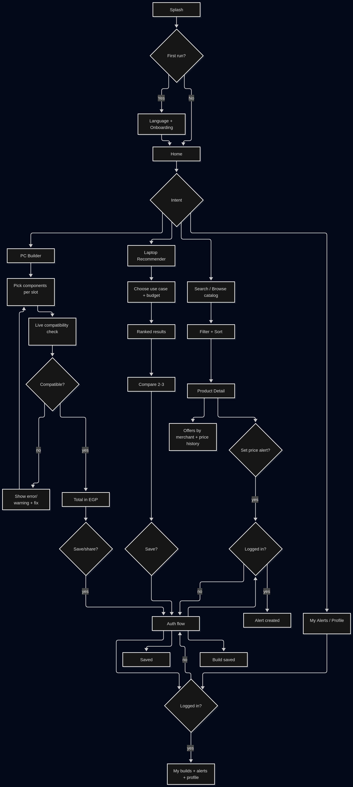
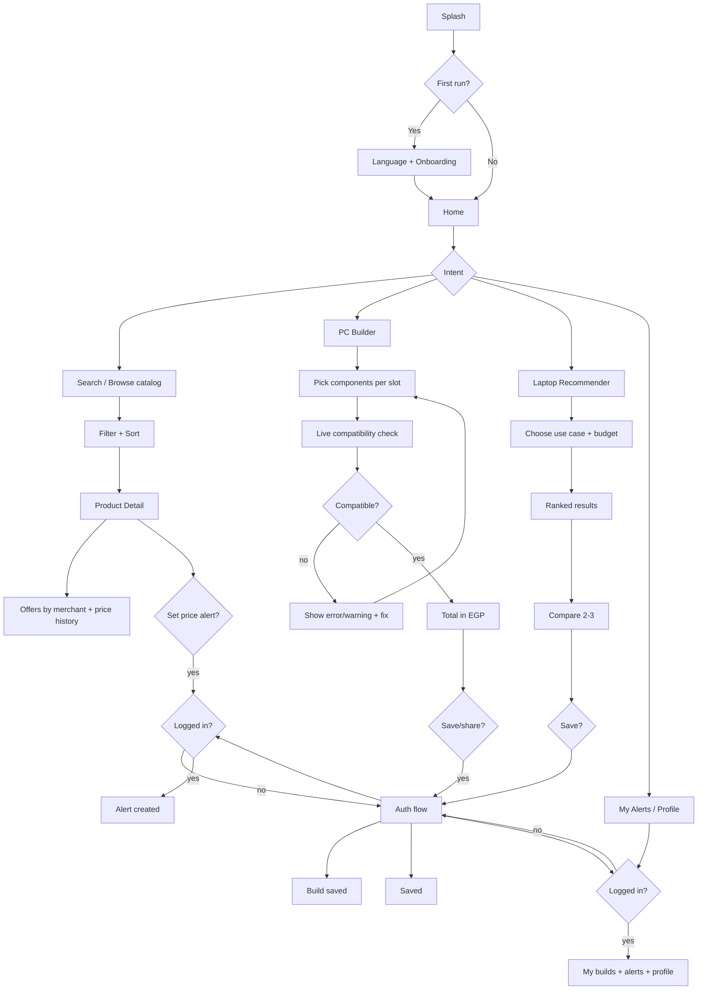

# Tagme3a (تجميعة) — Full MVP Plan

Production-grade mobile app for the Egyptian computer hardware market: EGP-denominated
custom PC builder, laptop recommendation engine, and live multi-merchant price tracker.

---

## 1. Monorepo layout

```
tagme3a/
├── app/                          # (optional) or keep Flutter at root
├── backend/
│   ├── app/
│   │   ├── main.py
│   │   ├── core/                 # config, security, db session, logging
│   │   ├── api/v1/               # routers (auth, products, builder, laptops, prices)
│   │   ├── models/               # SQLAlchemy 2.0 ORM
│   │   ├── schemas/              # Pydantic v2
│   │   ├── services/             # matcher, compatibility, recommender, pricing, text_gen
│   │   ├── scrapers/             # base.py + sigma.py, compumarts.py, nekhely.py
│   │   ├── workers/              # arq tasks + scheduler
│   │   └── data/                 # seed data: cpus, gpus, sockets, compat matrix
│   ├── alembic/
│   ├── tests/
│   ├── pyproject.toml            # uv/poetry, ruff, mypy, pytest
│   └── Dockerfile
├── docker-compose.yml            # postgres(pgvector), redis, meilisearch, api, worker
├── .github/workflows/            # ci.yml (backend + flutter)
└── (existing Flutter files)
```

Flutter `lib/` becomes feature-first:

```
lib/
├── main.dart
├── app.dart                      # MaterialApp.router, theme, locale
├── core/                         # theme, network(dio), router, storage, i18n, utils
├── features/
│   ├── catalog/{data,domain,presentation}/
│   ├── builder/{data,domain,presentation}/
│   ├── laptops/{...}/
│   ├── prices/{...}/
│   ├── auth/{...}/
│   └── alerts/{...}/
└── shared/                       # widgets, models shared across features
```

---

## 2. Backend architecture

**Runtime:** Python 3.12, FastAPI, Pydantic v2, SQLAlchemy 2.0 async, Alembic,
PostgreSQL 16 + **pgvector**, Redis, Meilisearch, arq (worker) + arq cron (scheduler).

### Core domain models

| Table | Purpose |
|---|---|
| `users` | auth, roles (user/admin/reviewer) |
| `products` | **canonical** product (brand, category, model, normalized specs JSONB, image, slug) |
| `product_specs` | typed spec rows (or JSONB) for compat checks |
| `merchants` | store metadata, scraper adapter key, base URL |
| `offers` | merchant ↔ product link, url, current price EGP, stock, last_seen_at, match_confidence |
| `price_history` | append-only (offer_id, price, in_stock, captured_at) |
| `raw_snapshots` | raw HTML/JSON per scrape (audit + reparse) |
| `staging_listings` | parsed-but-unnormalized rows pending match |
| `components` | CPU/GPU/board/RAM/PSU/case/cooler/storage compat attributes |
| `builds` | saved user builds (JSONB component ids, total, compatibility result) |
| `laptop_profiles` | scoring weights per use-case |
| `alerts` | user price-drop subscriptions |
| `fx_rates` | EGP reference rates + timestamps |
| `resources` | curated article/video/doc (`type`, `url`, `youtube_id`, `language`, AR/EN title/description, `is_available`) |
| `combination_resources` | resource ↔ `combination_key` (build parts / laptop pick), `relevance`, `is_curated` |
| `build_resources` | resource ↔ saved build |
| `device_tokens` | user ↔ FCM push tokens (platform) |
| `interaction_events` | append-only user events (view/save/click/outbound) for future ranking + content popularity |

### API surface (v1)

- `POST /auth/register`, `POST /auth/login`, `POST /auth/refresh`, `GET /auth/me`
- `GET /products?q=&category=&min=&max=&merchant=&sort=` (search via Meilisearch)
- `GET /products/{id}` (offers + price history + specs)
- `GET /products/{id}/offers`, `GET /products/{id}/price-history`
- `POST /builder/validate` (send component ids → compatibility report + total)
- `POST /builder/optimize` (budget + use-case → suggested builds)
- `GET /laptops/recommend?use_case=&budget=`
- `POST /alerts`, `GET /alerts`
- Admin: `POST /admin/listings/{id}/match`, `GET /admin/review-queue`, `POST /admin/resources`, `POST /admin/combinations/{key}/resources`
- Content: `GET /combinations/{combination_key}/resources`

### Compatibility engine (`services/compatibility.py`)

Rule matrix seeded from `data/`:

- socket (CPU↔board)
- RAM type/DDR (CPU/board↔RAM)
- form factor (board↔case)
- max GPU length (GPU↔case)
- cooler height (cooler↔case)
- PSU wattage headroom (est. load ×1.25–1.3, connectors)
- M.2/SATA (storage↔board)

Output: `{compatible: bool, issues: [{severity, code, message, components}]}`.
OS/BIOS caveats surfaced as warnings.

### Matching pipeline (`services/matcher.py`)

1. Scrape → `raw_snapshots`
2. Parse → `staging_listings`
3. Normalize (brand/model/spec extraction, alias tables, `rapidfuzz`)
4. Embed + pgvector nearest neighbor + rule gates
5. Auto-link if confidence ≥ threshold; else → review queue
6. Manual review promotes/rejects and feeds alias learning

### Scrapers (`scrapers/`)

`BaseScraper` interface: `fetch() -> raw`, `parse(raw) -> listings`, `key`.
httpx + selectolax; Playwright fallback flag per merchant. Per-merchant throttling,
UA rotation, robots check, failure alerting (scraper "health" metric,
consecutive-failure threshold).

### Jobs (arq cron)

- `scrape_all` (staggered per merchant)
- `recompute_offers` (ghost-inventory: no change/stale `last_seen_at` → mark unverified)
- `fx_update`
- `price_drop_notify` (query alerts, dispatch FCM)

---

## 3. Flutter app architecture

- **State:** Riverpod 3 (`AsyncNotifier`, providers per feature).
- **Routing:** go_router with deep links (`/product/:slug`, `/build/:id`).
- **Network:** dio + interceptors (auth refresh, retry, EGP error mapping); generated
  typed client from OpenAPI (`openapi_generator`/`retrofit`).
- **Models:** `freezed` + `json_serializable`.
- **Offline:** drift (SQLite) cache for catalog + last prices; stale badge when offline.
- **i18n:** `flutter_localizations` + `intl`; AR (default, RTL) + EN; **Cairo** font;
  `NumberFormat.currency(symbol: 'ج.م'/'EGP', locale)`.
- **Theme:** Material 3, dark/light, seed color, Arabic-safe typography.
- **Push:** firebase_messaging for price-drop alerts.
- **Images:** cached_network_image with placeholders.
- **Analytics/crash:** Firebase Analytics + Sentry.

### Screens (MVP)

Home (categories, deals) · Search/Browse · Product detail (offers table, price chart) ·
PC Builder (picker w/ live compat warnings + total) · Build results/optimizer ·
Laptop recommender · Alerts · Auth · Profile/Saved builds.

---

## 4. Milestones & deliverables

### M0 — Foundation (repo + tooling)

- Restructure to monorepo, scaffold `backend/`, docker-compose (pg+pgvector, redis, meili).
- Backend config/session/logging, Alembic baseline, health endpoint, ruff/mypy/pytest, Dockerfile.
- CI: backend lint + test (Flutter CI is owned by the separate client workstream).
- **Exit:** `docker compose up` serves `/health` and `/ready`.

> The Flutter client is handled by a different workstream; milestones below list
> backend deliverables only.

### M1 — Catalog + Auth

- Models `products/offers/price_history/merchants/users`; migrations.
- Firebase ID-token verification with Postgres-owned profile/roles (credentials stay in Firebase).
- Meilisearch indexing + search endpoints; product CRUD (admin); best-offer ranking.
- **Exit:** seeded catalog is searchable, product detail returns ranked offers, and
  `/auth/sync` + `/auth/me` work with a verified Firebase token.

### M2 — Scraping MVP

- `BaseScraper` + **Sigma** and **Compumarts** adapters; raw→staging.
- arq worker + cron; price history; ghost-inventory marking.
- Admin review queue (basic).
- **Exit:** daily prices flowing for 2 merchants; price history available via API.

> **Status (2026-11-27):** implemented on `backend` (runbook: `backend/M2.md`).
> Raw snapshots, staging, run health, Sigma/Compumarts adapters with fixture tests,
> arq daily cron (02:00 UTC scrape, 02:30 UTC ghost recompute), admin review queue,
> scraper health and manual enqueue are in place. Live selectors still need tuning
> against real merchant HTML; reviewer-role enforcement and fuzzy/pgvector matching
> remain in M3.

### M3 — Normalization & Matcher

- Canonical schema hardening, alias tables, rapidfuzz + pgvector matching,
  confidence thresholds, admin review queue API.
- **Exit:** ≥90% auto-match on target merchants; low-confidence queued.

### M4 — PC Builder

- Component data seed (CPU/GPU/board/RAM/PSU/case/cooler/storage + compat matrix).
- `compatibility.py` + `/builder/validate`; budget optimizer (`/builder/optimize`).
- Saved builds API.
- **Exit:** `/builder/validate` and `/builder/optimize` return compatible builds within budget.

### M5 — Laptop Recommender

- Scoring weights per use-case (gaming/engineering/editing/3D/student) + budget tiers.
- `/laptops/recommend` API.
- **Exit:** recommendations ranked and explained via API.

### M6 — Alerts & Release Polish

- FCM device-token registration and price-drop alert delivery from the backend.
- API support for stale/offline badges and analytics events; performance pass.
- **Exit:** price-drop alerts are emitted and delivered via FCM.

---

## 5. Cross-cutting decisions locked

- API contract-first: FastAPI OpenAPI → generated Dart client (prevents model drift).
- Every price carries `captured_at` + `source`; UI never presents stale as live.
- Raw snapshots retained (audit / reparse after store HTML changes).
- One merchant = one adapter = one health metric (scrapers break often).
- Confidence-gated auto-matching + human review; **legal review before scraping any store**
  and prefer commercial data agreements.

## 5a. AI-assisted AR/EN phrasing (single model use)

We will use a **small online model** (e.g. Gemini Flash free tier) **only** to rephrase English titles/facts into Arabic and English descriptions/labels for curated videos and articles. No model is used to discover or rank content.

- **Provider-agnostic**: `backend/app/services/text_gen.py` with adapters for hosted APIs; one method `generate(context, lang, task="rephrase")`.
- **Precompute + cache**: generate once at curation (or via a batch job) and store in `resources.title_ar`, `resources.description_ar`, `resources.description_en`. Runtime calls are avoided.
- **Strict guardrails**: prompts always inject DB values; the model must not invent specs/prices/URLs.
- **Graceful fallback**: on failure, fall back to original title/templates — app never breaks.
- **Scope**: output-only, bilingual phrasing. No decision-making, no compatibility checks, no price logic.

### 5b. Curated videos/articles (no model for listing)

- Curated manually via admin (or seed script). Stored in `resources` + `combination_resources` (`is_curated=true`).
- Ordered on response: `language priority (ar → en) → is_curated → relevance`. Plain sorting; no model.
- Video → `youtube_player_flutter` inline; article → `url_launcher` external.
- Dead links are pruned via the YouTube API (`videos.list`) on a nightly schedule; no model.
- AR/EN labels/descriptions may be filled by the phrasing model (5a).

---

## 6. Key risks

| Risk | Mitigation |
|---|---|
| Scraper breakage | adapter isolation, health alerts, raw snapshot reparse |
| Legal/ToS | review + merchant agreements; throttle/robots |
| EGP volatility & stale prices | timestamped prices, FX cache, stale badges |
| Matching accuracy | confidence gates + review queue + alias learning |
| Compat data completeness | dedicated seed dataset + tests, warnings not silent failures |
| Scope creep | phase gates above; MVP = M0–M6 only |

---

## 7. Functional Requirements (FR)

Priority scale: **M** = Must (MVP), **S** = Should, **C** = Could, **W** = Won't (this release).

### FR-1 — Authentication & Accounts

| ID | Requirement | Priority |
|---|---|---|
| FR-1.1 | Register/login with email + password (JWT access + refresh) | M |
| FR-1.2 | Persistent session, silent token refresh | M |
| FR-1.3 | Role-based access: user / admin / reviewer | M |
| FR-1.4 | Password reset, logout, account deletion | S |
| FR-1.5 | Social login (Google) | C |

### FR-2 — Catalog & Search

| ID | Requirement | Priority |
|---|---|---|
| FR-2.1 | Browse products by category (CPU, GPU, motherboard, RAM, PSU, case, cooler, storage, laptop, peripherals) | M |
| FR-2.2 | Full-text search with Arabic + English support | M |
| FR-2.3 | Filter by category, price range (EGP), merchant, brand, availability | M |
| FR-2.4 | Sort by price, popularity, recency, best offer | M |
| FR-2.5 | Product detail: images, specs, all merchant offers, price timeline | M |
| FR-2.6 | Show lowest current price + spread across merchants | M |
| FR-2.7 | Pagination / infinite scroll | M |
| FR-2.8 | Faceted search (socket, DDR type, VRAM size) | S |

### FR-3 — Price Tracking & Merchants

| ID | Requirement | Priority |
|---|---|---|
| FR-3.1 | Scheduled scraping per merchant (adapter per store) | M |
| FR-3.2 | Store append-only price history with timestamps | M |
| FR-3.3 | Each offer links back to the merchant product URL | M |
| FR-3.4 | Ghost-inventory detection (stale price/stock) | M |
| FR-3.5 | Display "last verified" time and stale indicator | M |
| FR-3.6 | Price-drop notifications (push) | M |
| FR-3.7 | FX rate tracking (if USD-denominated sources) | S |
| FR-3.8 | Merchant health/failure dashboard (admin) | S |

### FR-4 — Product Normalization & Matching

| ID | Requirement | Priority |
|---|---|---|
| FR-4.1 | Canonical product schema independent of merchant listing titles | M |
| FR-4.2 | Auto-match scraper listings to canonical products (fuzzy + vector) | M |
| FR-4.3 | Confidence scoring per match | M |
| FR-4.4 | Admin review queue for low-confidence matches | M |
| FR-4.5 | Manual promote/reject + alias learning | S |
| FR-4.6 | Raw snapshot retention for reparse | S |

### FR-5 — PC Builder

| ID | Requirement | Priority |
|---|---|---|
| FR-5.1 | Select components per slot with live compatibility checks | M |
| FR-5.2 | Compatibility engine (socket, DDR, form factor, GPU length, cooler height, PSU wattage, storage) | M |
| FR-5.3 | Display per-issue severity (error/warning) | M |
| FR-5.4 | Running total in EGP using lowest available offers | M |
| FR-5.5 | Budget optimizer: suggest a compatible build within a budget + use case | M |
| FR-5.6 | Save / name / share builds | S |
| FR-5.7 | Estimate bottleneck / performance balance | C |

### FR-6 — Laptop Recommendation

| ID | Requirement | Priority |
|---|---|---|
| FR-6.1 | Recommend laptops by use case + budget | M |
| FR-6.2 | Weighted scoring model per use case (gaming/engineering/editing/3D/student) | M |
| FR-6.3 | Explain ranking rationale | S |
| FR-6.4 | Compare 2–3 laptops side by side | C |

### FR-7 — Alerts & Notifications

| ID | Requirement | Priority |
|---|---|---|
| FR-7.1 | Subscribe to price-drop alert for a product | M |
| FR-7.2 | Push delivery via FCM | M |
| FR-7.3 | Manage/manage-list alerts | M |
| FR-7.4 | Threshold or any-drop configuration | S |

### FR-8 — Admin & Operations

| ID | Requirement | Priority |
|---|---|---|
| FR-8.1 | CRUD canonical products + compatibility data | M |
| FR-8.2 | Manage merchants + trigger manual scrape | M |
| FR-8.3 | Review queue actions | M |
| FR-8.4 | Audit log of price changes / matches | S |

### FR-9 — Localization & Presentation

| ID | Requirement | Priority |
|---|---|---|
| FR-9.1 | Arabic (default, RTL) + English UI | M |
| FR-9.2 | EGP currency formatting (ar_EG / en_EG) | M |
| FR-9.3 | Dark + light theme | S |
| FR-9.4 | Offline browsing of cached catalog + last prices | S |

---

## 8. Non-Functional Requirements (NFR)

### NFR-1 — Performance

- API p95 latency < 300 ms for read endpoints (cached), < 800 ms uncached.
- Search results returned < 500 ms for p95.
- App cold start < 2.5 s on mid-range Android; 60 fps scrolling.
- Product detail renders < 1 s (with cached thumbnail).
- Scrape job completes within a defined window without blocking API.

### NFR-2 — Scalability

- Support horizontal API scaling (stateless, shared Postgres/Redis).
- Handle 10k+ canonical products and 100k+ historical price rows in MVP without redesign.
- Scraping scales per-merchant (add adapter = new worker queue).
- Meilisearch/Redis independent of API availability.

### NFR-3 — Reliability & Availability

- Target 99.5% API uptime (post-launch).
- Scraper failures never corrupt canonical data (staging isolation).
- Idempotent jobs; retries with backoff; dead-letter for failed tasks.
- Graceful degradation: search/catalog usable if scraper pipeline is down.

### NFR-4 — Data Integrity

- Prices are append-only; never overwrite history.
- Every price carries `source`, `captured_at`, `currency`.
- Stale prices clearly marked; never presented as live.
- FK/constraint integrity enforced at DB level; migrations versioned (Alembic).

### NFR-5 — Security

- Passwords hashed (bcrypt/argon2); JWT short-lived access + rotating refresh.
- TLS everywhere; secrets via env/secret manager (never in repo).
- Input validation via Pydantic; ORM parameterization (no raw SQL injection).
- Rate limiting on auth + public endpoints (Redis).
- Role-based authorization on all admin routes.
- No scraping of authenticated/paywalled content without authorization.

### NFR-6 — Privacy & Legal/Compliance

- GDPR-style data handling: consent, export, delete account.
- Egypt PDPL-aligned data practices where applicable.
- Respect `robots.txt`, merchant ToS; prefer commercial data agreements.
- PII minimization; encrypted at rest where feasible.

### NFR-7 — Usability & Localization

- Full RTL correctness (mirrored layouts, icons, charts).
- Arabic-safe typography (Cairo/Tajawal); no broken ligatures.
- Accessible tap targets, contrast (WCAG AA target), screen-reader labels.
- Clear empty / loading / error / offline states everywhere.

### NFR-8 — Maintainability

- Typed API contract: FastAPI OpenAPI → generated Dart client.
- Feature-first Flutter structure; backend layered (api/services/models).
- Linting + formatting enforced (ruff/black, `flutter analyze`).
- ≥70% test coverage on compatibility + matcher + pricing logic.
- Documented compatibility rule set as versioned data, not hardcoded.

### NFR-9 — Observability

- Structured logs (request id, user id, latency).
- Error tracking (Sentry) in backend + Flutter.
- Metrics: scrape success rate, match confidence distribution, p95 latency.
- Alerts on scraper consecutive failures and error-rate spikes.

### NFR-10 — Portability & Deployment

- Containerized (Docker Compose local; reproducible builds).
- CI runs lint + tests for backend and app on every PR.
- Config via environment variables; no environment-specific code paths.
- Mobile targets: Android + iOS; responsive phone/tablet layouts.

### NFR-11 — Cost & Resource Efficiency

- Aggressive caching (Redis + CDN for images) to limit DB load.
- Scraper politeness (throttling) to avoid IP bans and infra cost spikes.
- pgvector + Meilisearch chosen to avoid heavyweight external ML services in MVP.

### Requirement traceability (sample)

| Requirement | Milestone |
|---|---|
| FR-2, FR-9, NFR-8, NFR-10 | M0–M1 |
| FR-3, FR-4, NFR-3, NFR-9 | M2–M3 |
| FR-5, NFR-4 | M4 |
| FR-6 | M5 |
| FR-7, NFR-6, NFR-7 | M6 |

---

## 9. User Flows



Personas: **Guest**, **Registered user**, **Admin/Reviewer**.

### 9.1 Onboarding & Entry

```
App launch
  ├─ First run ──► Splash → Language select (AR default / EN) → Onboarding (3 slides)
  │                     └─► Home (Guest mode)
  └─ Returning ──► Splash → restore session (token)
                        ├─ valid  ──► Home (logged in)
                        └─ expired ──► silent refresh → Home
                                        └─ refresh fails ──► Home (Guest) + "Sign in" prompt
```

Guest can browse, search, view prices, and use the builder; login required only to
**save builds, set alerts, and sync**.

### 9.2 Master flow (Mermaid)



### 9.3 Detailed journeys

**A. Guest → Buyer discovery (most common)**

1. **Splash** → lands on **Home** (no login wall).
2. Home shows: categories, "best deals" (largest price drop), trending.
3. Taps category or searches → **Search/Browse** list.
4. Applies filters (price min/max, brand, merchant, availability) → results update.
5. Taps a product → **Product detail**:
   - images, specs, **offers table** (merchant, price EGP, stock, last verified)
   - **price history chart**, lowest-price badge
   - stale/ghost badge if not recently verified
6. Taps merchant offer → opens store URL in browser (`url_launcher`).
7. Optional: taps **"Alert me on price drop"** → triggers **Auth flow** → alert created.

**B. Auth flow (triggered by a gated action)**

1. Gated action (save build / set alert / profile) → **Sign in / Register** sheet.
2. Register: email + password → validation → JWT issued.
3. Login: credentials → access + refresh tokens stored securely.
4. Returns to the **original action** with context preserved (deep-link return).
5. Forgot password → email reset link (FR-1.4).

**C. PC Builder (the core journey)**

1. From Home → **Builder** (may start from a preset budget build or blank).
2. Selects slot (CPU → Motherboard → RAM → GPU → PSU → Case → Cooler → Storage).
3. On each pick, **compatibility engine** runs:
   - 🔴 errors block progression (e.g., wrong socket, DDR mismatch)
   - 🟡 warnings allowed (e.g., PSU headroom low, BIOS update needed)
4. Total EGP recomputes live using **lowest in-stock offer** per component.
5. Taps **"Optimize for my budget"** → enters budget + use case → engine returns
   suggested complete builds.
6. Saves/named → **Auth flow** if guest → build persisted.
7. Share build → generates a deep link (`/build/:id`).

**D. Laptop Recommender**

1. Home → **Laptops**.
2. Chooses **use case** (gaming / engineering / editing / 3D / student) + **budget slider**.
3. Receives **ranked list** with rationale ("best GPU per EGP in budget").
4. Optionally compares 2–3 side by side.
5. Saves to profile (auth-gated) or sets a price alert.

**E. Price-drop alert lifecycle (returning user)**

1. User previously set alert on a product.
2. Scheduler/scraper captures new price → `price_drop_notify` job detects drop below rule.
3. FCM push sent → tap opens **Product detail** deep link.
4. User reviews offers → taps merchant link to buy.
5. Manages alerts via **My Alerts** (list, edit threshold, delete).

**F. Admin/Reviewer flow (back-office, not the mobile consumer app)**

1. Login (admin role) → **Admin**.
2. **Review queue**: low-confidence scraper↔product matches.
3. Promotes/rejects; alias learning improves future matching.
4. Manages canonical products + compatibility dataset.
5. Triggers manual scrape; views merchant health dashboard.

### 9.4 Flow edge cases / branches

| Situation | Behavior |
|---|---|
| Offline | Show cached catalog + last prices with **stale badge**; block buy actions |
| No offers in stock | Product visible, marked "out of stock everywhere"; alert CTA emphasized |
| Scraper hasn't verified price recently | "Last verified 6 days ago" + ghost-inventory warning |
| Compatibility conflict | Hard errors with the specific conflicting components |
| Token expired mid-action | Silent refresh; if fails, re-auth then resume action |
| Search returns nothing | Suggest category browse + clear filters |
| Budget too low for any build | Show closest achievable build + required minimum |

### 9.5 Screen map (navigation)

```
Splash → Home
Home ─┬─ Catalog ─┬─ Search/Browse → Product Detail
      │           └─ Category → Product Detail
      ├─ Builder ─┬─ Component Picker → Compatibility Result → Build Summary
      │           └─ Optimizer → Suggested Builds → Build Summary
      ├─ Laptops → Recommender → Compare → Detail
      ├─ Alerts (auth) → Alert Editor
      └─ Profile (auth) ─┬─ Saved Builds → Build Detail (deep link /build/:id)
                         ├─ Login/Register/Reset
                         └─ Settings (language, theme, notifications)
```

---

**Suggested first executable step:** M0 — restructure to monorepo, scaffold backend +
docker-compose, and set up Flutter feature-first foundation + CI.
